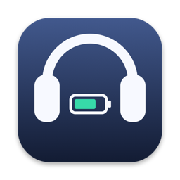
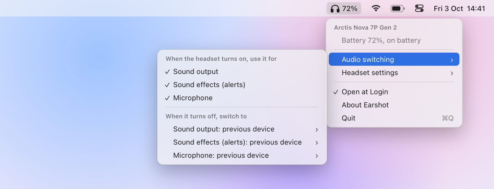
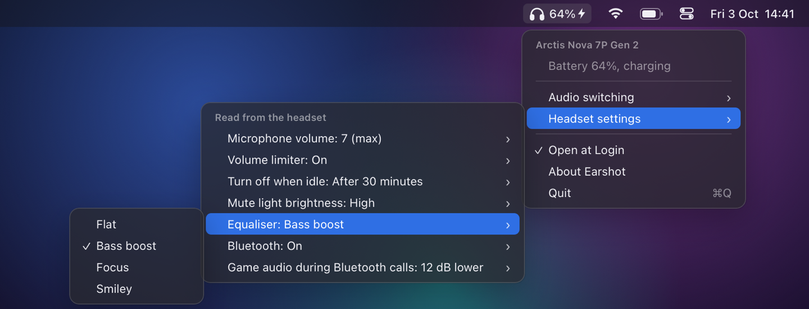

<p align="center"></p>

# Earshot

Battery, settings and audio switching for your headset, in the Mac menu bar. It was built for the SteelSeries Arctis Nova 7P and replaces SteelSeries GG there with one small app. Other headsets, from any brand, are welcome.

<p align="center"></p>

## Install

```bash
brew install gabrielbelli/tap/earshot
```

Then open Earshot from Applications and turn on Open at Login in its menu. The headphones icon shows while the headset's USB dongle is plugged in. Needs macOS 14 or later, Apple Silicon or Intel.

Earshot is not notarised. The Homebrew cask clears the quarantine flag so macOS opens it.

## What it does

- Shows battery, charging and whether the headset is on. The number turns red at 15%.
- Shows when the mic is muted.
- Moves the Mac's sound output, alert sounds and mic to the headset when it turns on, and back to the previous device, or one you choose, when it turns off. Each part can be turned off.
- Reads and changes the headset's settings: mic volume, volume limiter, idle power-off, mute light, EQ preset, Bluetooth, and game audio during Bluetooth calls. It sends a setting only when you pick one, so changes made in the phone app stay.

It talks to the dongle over USB. No driver, no background service, no account, no network, no permission prompts.

<p align="center"></p>

## Headsets

| Headset | USB ID | Status |
| --- | --- | --- |
| Arctis Nova 7P Gen 2 | `1038:2298` | Tested |
| Arctis Nova 7P, firmware from 2026 | `1038:22a7` | Should work, untested |
| Arctis Nova 7P, original firmware | `1038:220a` | Should work, untested. Battery in 25% steps |
| Arctis Nova 7, 7X, 7 Gen 2 | various | Not supported yet. Close relatives with different settings |

Your headset's USB ID is under System Information, USB. If you own one of these, or a wireless headset from another brand, a [device report](https://github.com/gabrielbelli/earshot/issues/new?template=device-report.yml) helps more than anything else.

## Other platforms

Earshot is Mac only. Elsewhere:

- Windows: [SteelSeries GG](https://steelseries.com/gg).
- Linux: [Arctis Sound Manager](https://github.com/loteran/Arctis-Sound-Manager), or [HeadsetControl](https://github.com/Sapd/HeadsetControl) on the command line. HeadsetControl also runs on Windows and macOS.
- iPhone and Android: SteelSeries Arctis Companion for [iOS](https://apps.apple.com/us/app/-/id6502297763) and [Android](https://play.google.com/store/apps/details?id=com.steelseries.arctiscompanion).

## Uninstall

```bash
brew uninstall earshot
```

Settings are in `~/Library/Preferences/com.gabrielbelli.Earshot.plist`.

## Build from source

```bash
./build.sh
```

That makes `build/Earshot.app`. It needs the Xcode command line tools and nothing else.

## Help

Device reports, bug reports, opinions and pull requests are all welcome. See [CONTRIBUTING.md](CONTRIBUTING.md). The USB protocol is in [docs/protocol.md](docs/protocol.md).

## Credits

[HeadsetControl](https://github.com/Sapd/HeadsetControl) and [Arctis Sound Manager](https://github.com/loteran/Arctis-Sound-Manager) worked out the USB protocol. Earshot reuses what they documented and none of their code.

Earshot is not affiliated with SteelSeries. Arctis and SteelSeries are their trademarks.

## Licence

[BSD 2-Clause](LICENSE).
